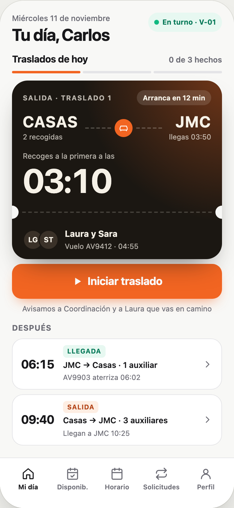
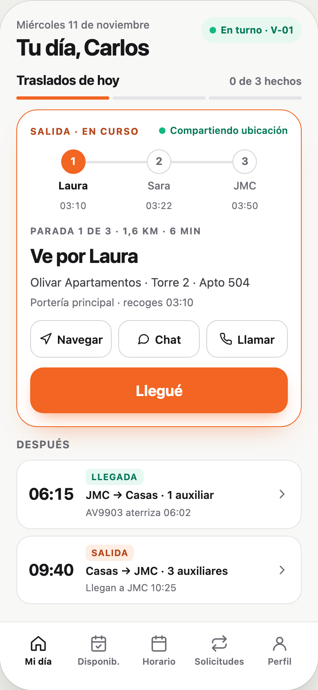
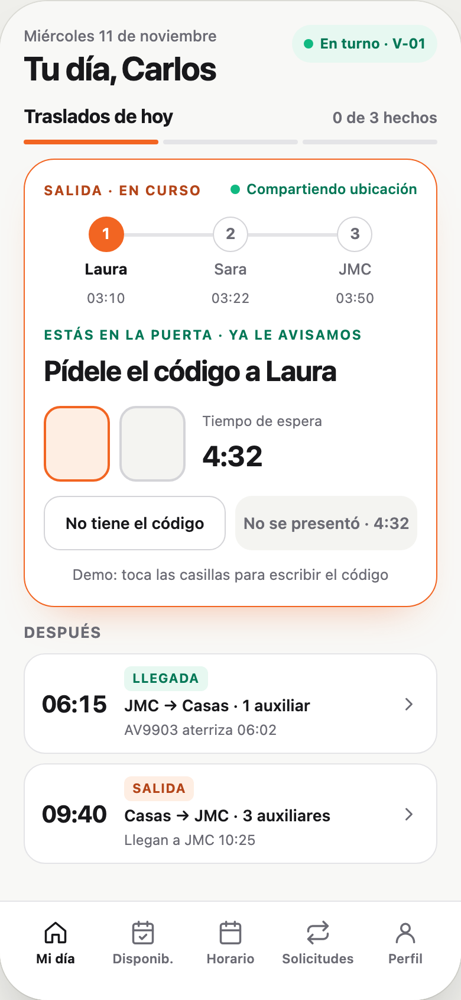
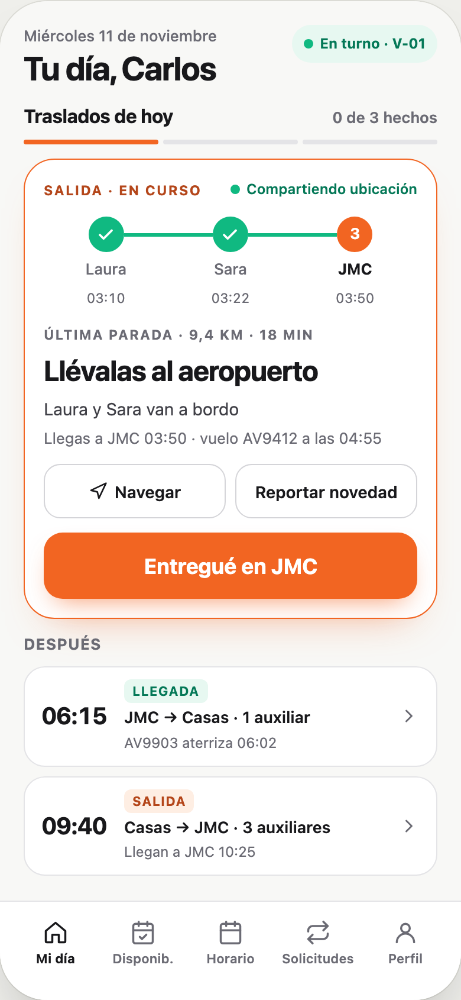
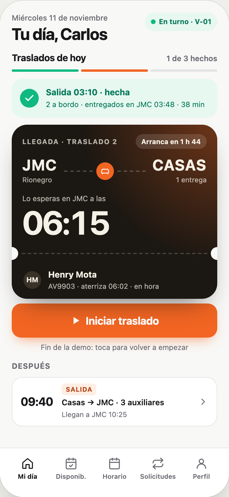
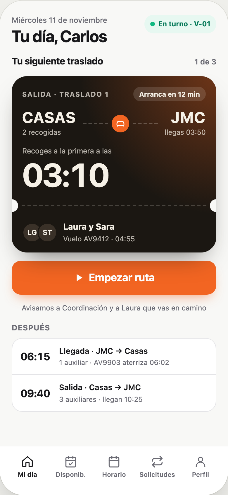
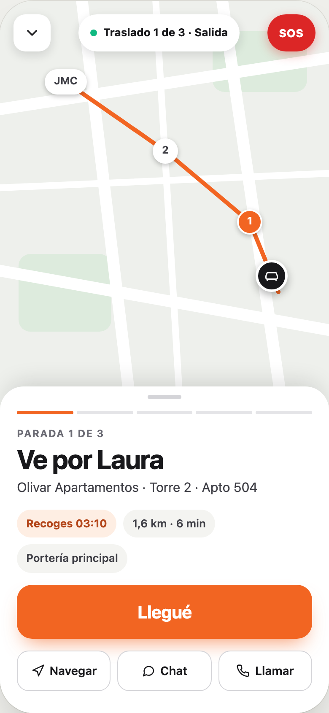
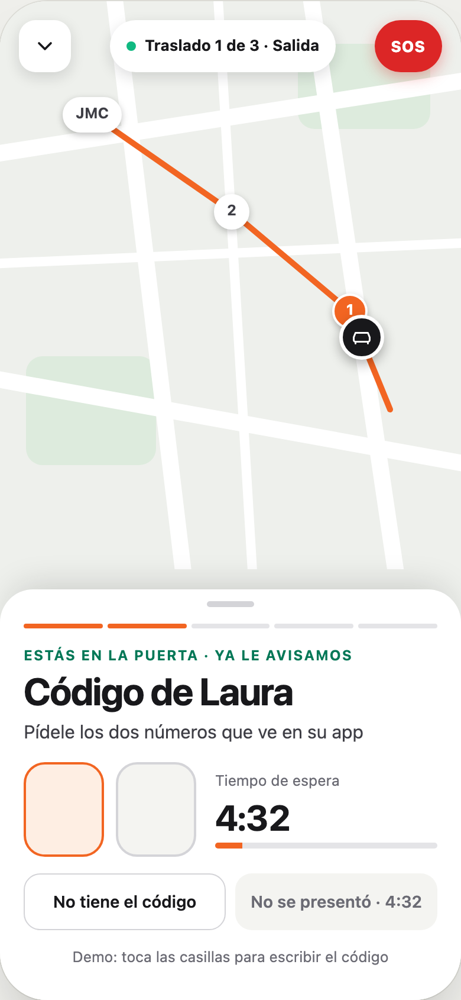
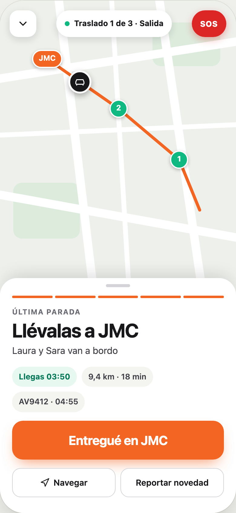
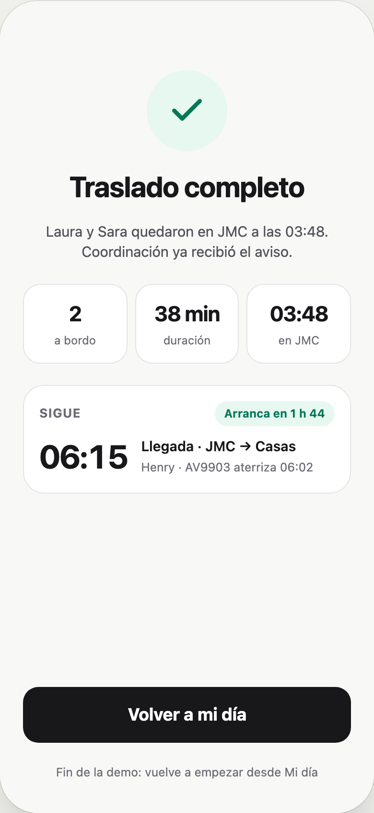

# Ruta del conductor: dos propuestas (12-nov-2026)

**Estado: propuesta para decidir.** Nada de esto está implementado. Esta carpeta no toca la app (`rendio-turnos/`) ni la base: son demos con datos de ejemplo.

## Por qué

1. **Al módulo del conductor le falta la personalidad de Rendio** que sí tiene el del tripulante (el pasabordo, las capas, el detalle fino). Hoy es una mezcla: las pestañas tienen un estilo, la ruta otro y el inicio de turno otro más viejo.
2. **Iniciar la ruta es complejo.** La lógica está bien; lo que enreda es la entrada:
   - hay dos listas de vueltas: «Tu día» en Inicio y «Mi día» en Ruta;
   - hay tres botones de «Iniciar ruta» (en Inicio, en Mi día y en el Detalle), más la entrada «Ruta · Trayectos de hoy» de la tarjeta del turno;
   - hay una pantalla de detalle en la mitad;
   - la pantalla de ejecución muestra muchas cosas a la vez.

**Regla de este rediseño: no se modifica la lógica.** Hay avisos, push y eventos colgados de cada marca del conductor. Lo único que cambia es cómo se presenta.

## Cómo verlas

- **`demo.html`**: ábrelo con doble clic en cualquier navegador. Trae las dos opciones lado a lado. Toca los botones naranjas para recorrer un traslado de salida completo. Para abrir en un paso puntual: `demo.html?a=2&b=2` (pasos 0 a 6).
- **`capturas/`**: las mismas pantallas como imágenes.
- **`lienzo/`**: las fuentes del lienzo de diseño donde se hicieron. Solo abren dentro del lienzo; `demo.html` se genera a partir de ellas con `node construir-demo.mjs`.

## Opción A · Por bloques de traslado

El día **es** la lista de traslados, parecido a la lista de WhatsApp. El siguiente se ve como pasabordo; al iniciarlo, ese mismo bloque se abre y muestra solo el paso que toca y un botón. No hay pantalla aparte.

| Mi día | En camino | Código | Aeropuerto | Hecho |
|---|---|---|---|---|
|  |  |  |  |  |

- **A favor:** nunca sales de «Mi día» y ves todo el día de un vistazo.
- **En contra:** el bloque queda apretado, sin mapa y con botones más chicos para alguien que va manejando.

## Opción B · Ruta completa, un paso a la vez

«Mi día» solo destaca el siguiente traslado. Al empezar entra a un modo enfocado: mapa arriba, una sola instrucción y un botón grande. Se puede minimizar y volver; al terminar muestra el traslado que sigue.

| Mi día | En camino | Código | Aeropuerto | Completo |
|---|---|---|---|---|
|  |  |  |  |  |

Al minimizar, «Mi día» muestra el traslado «En curso» y el botón pasa a «Volver a la ruta» (`capturas/B6-minimizada.png`). La ubicación se sigue compartiendo, igual que hoy.

- **A favor:** imposible perderse; es lo más cómodo y seguro al volante.
- **En contra:** mientras estás en ruta no ves el resto del día.

## Recomendación: la mezcla

**El día en bloques de la A para ver y planear, y el modo enfocado de la B para ejecutar.** Queda una sola lista, un solo botón de inicio y un paso por pantalla.

## Lo que no cambia

Cada botón de las demos corresponde a una acción que ya existe en `rendio-turnos/driver-rutas.js`. La implementación debe llamar exactamente lo mismo:

| Botón en la demo | Función de hoy | Qué dispara |
|---|---|---|
| Iniciar traslado / Empezar ruta | `start()` | `Api.driverRouteStarted` (aviso a los jefes) + estado `en_route` de la primera parada («va en camino») + GPS |
| Llegué | `arrive()` | estado `at_pickup` («tu conductor llegó»); si el GPS dice que está lejos, pide confirmar antes de avisar. En llegadas: `Api.driverMarkAirportArrival` |
| Casillas del código | `board()` | `Api.driverBoardWithCode` (la base valida el código) |
| No tiene el código | `board(…, sin código)` | a bordo sin código |
| No se presentó | `noShow()` → `noShowYes()` | solo después del tiempo de espera y con confirmación; estado `no_show` |
| Entregué en JMC | `finish()` | estado `delivered` de los que van a bordo |
| Navegar, Chat, Llamar, Reportar novedad, SOS | los de hoy | sin cambios |

También quedan iguales la cola de marcas cuando no hay señal, el envío de ubicación cada 6 segundos mientras hay un traslado en curso y el avance guardado en el teléfono.

## Lo que falta dibujar

- **La llegada** (recoger en JMC a varios, cada uno con su código, y repartir en las casas).
- Las vueltas para tomar, agregar o soltar gente y la entrega de turno.
- El resto del conductor en el mismo lenguaje: Disponibilidad, Horario, Solicitudes, Perfil e Iniciar turno.
- Las propuestas de **Asignación** para el jefe (van aparte).

## Notas

- Los nombres, horas, direcciones y vuelos de las demos son ficticios.
- Colores, tipografías y medidas salen de los tokens del módulo del tripulante (`rx-auxiliar.css`): fondo `#F8F8F6`, naranja `#F26522`, pasabordo `#1B1712`.
